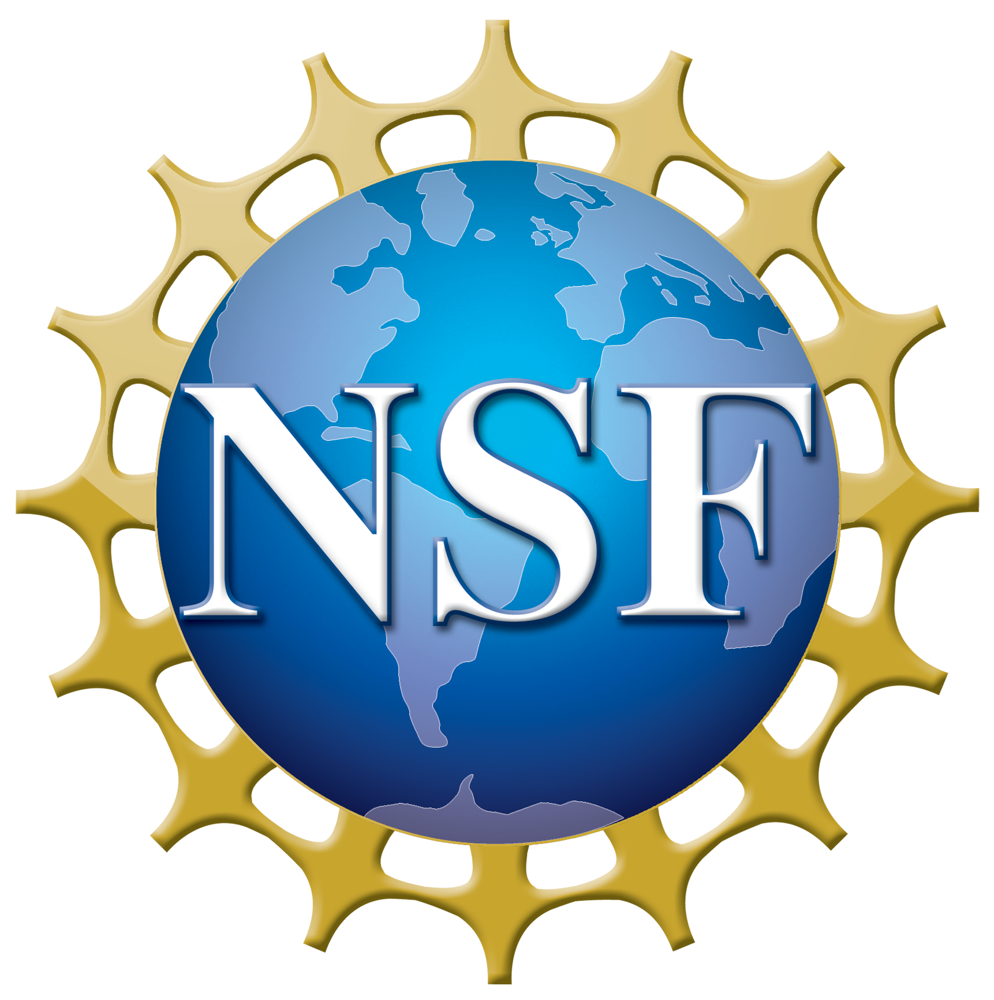

# DragonRadio

This is Drexel's software-defined radio. Please see the [DragonRadio documentation](https://drexelwireless.github.io/dragonradio/) for further information.

## Hardware-free simulation and OFDMA prototype

The experimental simulation mode runs on macOS or Linux with Python and NumPy,
without building UHD/liquidDSP or creating a TAP device:

```sh
python3 -m venv .venv-simulation
.venv-simulation/bin/python -m pip install -r requirements-simulation.txt
.venv-simulation/bin/python scripts/standalone-radio.py --simulate --frames 200
make sim-test PYTHON=.venv-simulation/bin/python
```

It includes a static single-transmitter/two-receiver OFDMA reference PHY and an
optional baseline for the existing native liquidDSP modem. See
[the simulation guide](docs/simulation.rst) for scope, experiments, IQ export,
acceptance criteria, and the remaining steps toward radio integration.

The [native PHY guide](docs/native-phy.rst) covers the compiled non-liquidDSP
OFDM/OFDMA engine, direct liquidDSP benchmarks, streaming packet/frame adapter,
and optional UHD transport for future SDR-grid tests. With FFTW installed:

```sh
make phy-build sim-test frame-sim PYTHON=.venv-simulation/bin/python
make modem-build phy-benchmark PYTHON=.venv-simulation/bin/python
make grid-package PYTHON=.venv-simulation/bin/python
```

The legacy hardware radio's liquidDSP OFDM selection remains available. The new
frame engine does not yet replace the production C++ MAC/ARQ path.

 This project is supported by NSF awards [1717088](https://www.nsf.gov/awardsearch/showAward?AWD_ID=1717088) and [1730140](https://www.nsf.gov/awardsearch/showAward?AWD_ID=1730140).

OTA PHY campaigns: see [the SDR grid test procedure](docs/ota-grid.rst).
`python scripts/ota-phy.py prepare --campaign simulation-results/trial01` then
`python scripts/ota-phy.py simulate --campaign simulation-results/trial01` exercises
legacy OFDM, native OFDM and simultaneous two-user OFDMA without opening hardware.

Full-stack development and mixed-SDR benchmarking: see the
[Claude Code handoff](CLAUDE_FULLSTACK_BENCHMARK_PLAN.md) and
[the theory/software characterization](docs/characterization.rst).
