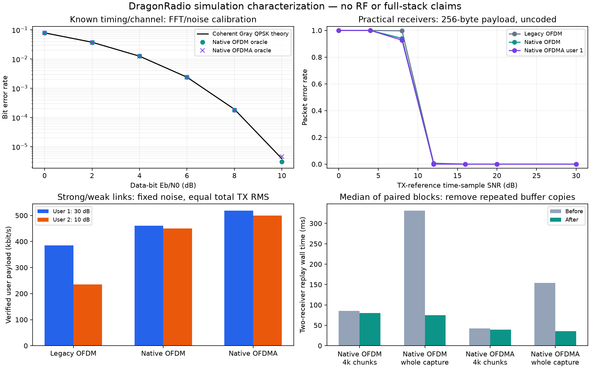

Theory-calibrated PHY and software characterization
===================================================

The development and deployment handoff is
``CLAUDE_FULLSTACK_BENCHMARK_PLAN.md`` at the repository root. It distinguishes
implemented code from proposed full-stack work, maps changes to actual C++
interfaces, and provides phase gates, a mixed-N210/X310 test design and analysis
instructions. ``grid/benchmark-matrix.json`` enumerates eight directed pair/
strength cells and 32 ordered transmitter/two-receiver/strength cells before
subband, environment, load and repetition factors.

Run the characterization
------------------------

After building both libraries, run without opening a radio::

    python scripts/characterize-phy.py --frames 100 --output simulation-results/characterization.json

Default: three independent seeds; 64/256-byte packets; seven SNRs; seven
channel profiles; all three PHYs. The report separates an ideal BER experiment,
practical decoder packet results, asymmetric two-user/TDMA controls and isolated
software workers. Use ``--quality-only`` and ``--software-only`` in separate
runs for controlled timing. The frame-level practical TX/RX timings collected
during quality runs are diagnostic; use dedicated software runs and the existing
warmed-kernel benchmark for confirmatory performance comparisons.

To reproduce the before/after comparison without modifying any source::

    python scripts/compare-software.py --frames 100 --repetitions 7 --blocks 3 \
      --output simulation-results/software-copy-comparison.json

This uses ``tests/reference_stream_v1.py``, a frozen copy of the receiver before
the cursor change, and validates identical replay input hashes. Run it on an
otherwise idle host, separately from the quality study.

The default software workers use 50 packets/user, five repetitions and chunks
of 97, 512, 4096, 65536 and the entire capture. The measured optimization study
used 100 packets/user and seven repetitions in three alternating before/after
blocks. Each backend worker has a separate process for peak RSS. Process
high-water RSS includes interpreter, native libraries and buffers; it is not
per-function allocation attribution or a leak test. Replay wall/CPU includes
constructing two receivers and processing noisy idle prefixes/suffixes. Native
OFDM and legacy use alternating destinations; OFDMA uses one simultaneous
waveform. All recovered packets must exactly match expected payloads in order.
Reported software p95/p99 from a few whole-capture repetitions are descriptive,
not reliable estimates of rare per-packet scheduling tails. The full-stack plan
requires longer service/queue measurements before declaring real-time readiness.

Theory and noise calibration
----------------------------

For coherent Gray QPSK, ``Pb = 0.5 erfc(sqrt(Eb/N0))``. A unitary FFT preserves
complex noise variance. Measure the actual transmitted native data-carrier
energy ``Es`` and inject sample-domain complex noise variance
``N0 = Es / (2 * 10**(EbNo_dB/10))``. Extract data symbols with known timing/channel
and compare hard bits **before** CRC selection. Scrambling is bijective and
preserves error counts. The oracle reports 95% Wilson intervals and a broad
six-sigma consistency check, not a proof of receiver optimality. Each default
point observes 652800 packet-envelope bits; a zero-error observation has a
nonzero uncertainty bound.

The independent hard-bit reference is ``PER = 1-(1-Pb)**Nbits``. It excludes
acquisition, channel estimation and the native bounded CRC-aided Chase search,
so practical PER need not equal it. Native oracle BER does not measure practical
raw BER in either native or liquid receivers. The practical report intentionally
leaves that quantity null until both receivers expose pre-CRC bits. Do not call
BER on CRC-accepted payloads a valid uncoded BER characterization.

Eb/N0 here refers to QPSK data bits, excluding CP/pilot/training overhead; the
measured time-sample SNR is logged separately. Payload-level energy efficiency
must account for those costs plus packet headers and padding. Reference nominal
goodput uses exact fixed-frame airtime and payload size. Full-stack analysis must
also count gaps, scheduling, feedback, retransmission and protocol overhead.
See the MathWorks `QPSK analytical expression`_ and `OFDM example`_.

.. _QPSK analytical expression: https://www.mathworks.com/help/comm/ug/analytical-expressions-used-in-berawgn-function-and-bit-error-rate-analysis-app.html
.. _OFDM example: https://www.mathworks.com/help/comm/gs/qpsk-and-ofdm-with-matlab-system-objects-1.html

Fixed-noise weak-link modeling
-----------------------------

``ChannelConfig(snr_db=...)`` retains its historical post-FIR SNR behavior for
existing tests. For link attenuation/fading, use
``ChannelConfig(snr_db=None, noise_power=variance, taps=...)``. Noise variance
then remains fixed when path gain changes; a 20-dB attenuation causes a 20-dB
SNR reduction. Supplying both SNR and fixed noise is rejected to prevent an
ambiguous experiment. This fixes a simulation-design limitation: previously,
weakening the FIR could automatically weaken the generated noise too.

The practical study uses noise from TX active-frame reference power, normalized
within-/beyond-CP channels, both CFO signs, flat block Rayleigh fading, and a
+50-ppm burst resampling stress. Rayleigh power fades now remain in the results.
The SFO interpolation is a first-order stress model, not a complete USRP clock/
resampler model; it also filters noise and must not be interpreted as an exact
hardware impairment distribution. Measured channels, long-stream drift, phase
noise, Rician fading, IQ imbalance and full-stack simulated I/O remain future
work identified in the handoff.

The asymmetric experiment uses equal total digital active RMS 0.08, fixed
receiver noise and per-user gains giving reference SNR pairs 30/30, 30/10,
10/30 and 10/10 dB. Legacy and native OFDM alternate the same two destination
payloads. OFDMA transmits both concurrently. Goodput charges all traffic
intervals and 64-sample gaps to both users; it does not divide by only successful
packets. Strong/weak here are diagnostic SNRs, not OTA calibration categories.
The hardware plan instead calibrates those categories from reference PER curves.

Executed findings and limits
----------------------------

The 2026-11-02 study used 100 frames/seed, three seeds, 294 practical
mode/channel/SNR/payload cells, 12 oracle BER points and 12 asymmetric controls.
All oracle consistency checks passed; no practical false accepts were observed.
This is exploratory characterization, not enough trials to certify rare PER.

AWGN robust-link cases passed; fixed-noise Rayleigh cases retain residual losses
at high reference SNR because some blocks are in deep fades. The pinned
liquidDSP negative-CFO failure persists on macOS arm64 but not on Linux x86_64;
see *Negative-CFO triage* below. Beyond-CP cases fail badly even at high
SNR; increasing CP or adding a suitable equalizer is required for that channel
envelope rather than hiding those cases in an average.

The software study identified repeated ``self.buffer[consumed:].copy()`` inside
the streaming acquisition loop. It copied the remaining capture for each
candidate/frame. The receiver now advances a cursor over views and copies the
remaining tail once per input chunk. Waveforms, decoder decisions, overlap,
absolute sample offsets and reset behavior are preserved and regression-tested.
The paired study results and plots are recorded with the generated report.
Native OFDM streaming remains slower than liquid in the measured replay conditions,
despite native's earlier warmed-burst advantage; two-user OFDMA depends on platform/chunk size. Persistent C++ acquisition,
ring buffers and amortized Python/FFI dispatch remain priority work before a
full-stack real-time performance claim.

Regenerate the figure using::

    python scripts/plot-characterization.py --study simulation-results/characterization.json \
      --software-comparison simulation-results/software-copy-comparison.json \
      --output docs/images/characterization.png

No results on this page are OTA measurements or production MAC/ARQ/FEC parity
claims. The preserved legacy OFDM backend remains the production fallback.

Paired replay result
--------------------

Three alternating before/after blocks, seven repetitions each, 100 packets/user:
whole-capture paired median speedups were 4.52x for native OFDM and 4.32x for
OFDMA. At 4096-sample chunks the corresponding figures were only 1.03x and
1.09x; the unchanged legacy control also varied around 1.05x, so the small-chunk
changes do not establish a strong performance gain. Whole-capture after medians
were about 74.5 ms for native OFDM and 35.8 ms for OFDMA versus 21.9 ms for the
legacy control, for two sequential receiver replays. These captures represent
different protocol airtimes, which are also recorded in the software reports.
Do not infer software parity with legacy from the copy optimization alone.

The full-stack handoff also requires a CRC-aided correction ablation before
broad receiver claims. The negative-CFO triage is complete (next section).

Negative-CFO triage (P0, 2026-11-02)
------------------------------------

Cause: undefined behavior in the pinned liquidDSP NCO, not the DragonRadio
wrapper, subcarrier mask, channel model or CFO estimator. ``nco_crcf_constrain``
in ``src/nco/src/nco.c`` converts a possibly negative ``double`` directly to
``uint32_t``. C leaves that conversion undefined. arm64 saturates it to 0, so
every negative NCO frequency set by the synchronizer becomes 0 Hz; x86_64
compilers usually produce the wrapped two's-complement value, which works.
Evidence, all noiseless with no wrapper:

* A standalone C driver linked to the pinned ``libliquid`` reproduces the
  failure with the experiment mask, its mirror image and liquid's default mask.
* Instrumented acquisition shows a correct S0 estimate (-0.1000 subcarrier for
  -0.10 injected) and successful S1 sync, but NCO frequency 0 afterwards; the
  header decodes and the payload fails from the uncorrected rotation.
* ``-fsanitize=float-cast-overflow`` reports the conversion at ``nco.c:345``.
* Replacing only that conversion with ``(uint32_t)(int64_t)round(...)`` restores
  full delivery from -0.55 to +0.55 subcarrier on arm64.
* The Linux x86_64 characterization already delivered 300/300 at -0.18.

Reproduce with ``python scripts/triage-liquid-cfo.py --output
simulation-results/liquid-cfo-triage.json``. It builds the patched NCO only as
a copy in ``build/triage``. The pinned comparator is unchanged, and existing
studies keep using it; a corrected comparator would be a separately labelled
version with its own rerun curves. Linux x86_64 grid nodes run the pinned
code without this symptom, but the behavior still relies on undefined
conversion, so record compiler/architecture with every legacy result.

The same sweep exposed a native limit: native OFDM and OFDMA acquire only from
about -0.25 to +0.25 subcarrier (preamble correlation metric falls below its
0.20 threshold at 0.30), narrower than corrected liquid's +/-0.55. At 1 MS/s
and FFT128 one subcarrier is 7.8125 kHz, so native tolerates about 2 kHz of
total relative offset. Measure real N210/X310 offsets in the cabled pilot; a
wider native acquisition (segmented/differential correlation or coarse CFO
search) is P4 work, not implemented.

Linux cross-check
-----------------

All 47 regression tests passed on the grid controller's Linux x86_64 workspace.
The same 294 practical cells, 12 oracle points and 12 asymmetric controls passed
the theory-consistency/no-false-accept checks. Separate isolated software
workers verified every replay. Linux reports are
``simulation-results/characterization-linux.json`` and
``simulation-results/characterization-software-linux.json``.

At 4096-sample chunks, Linux median two-receiver replay times were 84.9 ms
legacy OFDM, 132.3 ms native OFDM and 66.4 ms native OFDMA. These are after-change
measurements, not a Linux paired optimization study. Different waveform
airtimes and process CPU/represented-time ratios remain in the full reports.
This reinforces the need for platform/load-specific evidence and further
native OFDM streaming optimization before declaring full-stack software parity.
No radio was opened or RF transmitted during these checks.
