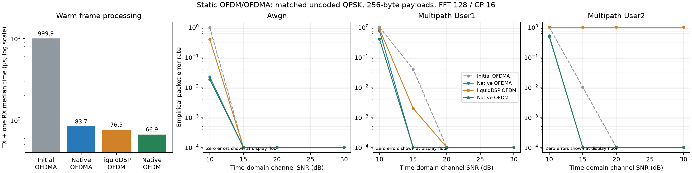

Native PHY benchmark evaluation
===============================

The compiled non-liquidDSP engine supports both single-user OFDM and static
two-user OFDMA. All six acceptance gates passed in this run. This is a matched
uncoded-QPSK frame-modem comparison, not a full production-MAC/FEC or OTA test.

Build and validation
--------------------

* Native C++/FFTW OFDM/OFDMA engine built successfully on macOS/arm64.
* The actual DragonRadio liquidDSP wrappers and pinned dependency also built.
* All 35 regression tests passed, including real liquidDSP modem round trip.
* Native OFDM delivered 1000/1000 packets in the default multipath simulation.
* Native OFDMA delivered 1000/1000 packets for each receiver in that simulation.
* Both frame-streaming modes delivered 100/100 packets per configured receiver.
* The source bundle was extracted and compiled/tested independently on this Mac.
  That checks packaging, not a Linux/grid build or physical SDR behavior.
  Its run passed 33 tests and skipped two optional liquidDSP-comparison tests
  because the comparison library was not built inside that clean extraction.

Environment: macOS-26.5.2-arm64-arm-64bit-Mach-O. Python 3.14.4, NumPy 2.5.4.
Payload: 256 bytes; FFT 128; CP 16; 1 MS/s; random seed 2026.
Timing samples: 1500 per operation after warm-up. Quality: 1000 frames per
channel/SNR condition, 12 conditions total. Receiver user ID 1 is evaluated in
each channel profile; the separate two-receiver simulation checks both users.

CPU timing
----------

.. list-table:: Median warm processing time (microseconds)
   :header-rows: 1

   * - Implementation
     - TX
     - One RX
     - TX + one RX
   * - Initial NumPy OFDMA
     - 264.38
     - 735.50
     - 999.88
   * - Optimized NumPy OFDMA
     - 110.62
     - 201.92
     - 312.54
   * - Native OFDMA
     - 26.79
     - 56.92
     - 83.71
   * - liquidDSP OFDM
     - 25.62
     - 50.88
     - 76.50
   * - Native OFDM
     - 20.08
     - 46.79
     - 66.88

Native OFDMA is 11.94 times faster than the first prototype by this
TX-plus-one-RX metric. Matched native OFDM is 1.144 times the liquidDSP
packet-processing speed. These are per-payload-frame timings: the custom OFDM
frame has 2160 samples versus 2592 for liquidDSP, so lower framing overhead
contributes to the difference. They are not raw-IQ throughput or complete-system
latency measurements. The new decoder additionally validates/parses its packet
envelope; the liquid bridge returns its CRC-valid payload bytes.

Packet delivery
---------------

.. list-table:: Verified single-user OFDM payloads
   :header-rows: 1

   * - Channel
     - SNR (dB)
     - Native OFDM
     - liquidDSP OFDM
   * - awgn
     - 10
     - 982/1000
     - 612/1000
   * - awgn
     - 15
     - 1000/1000
     - 1000/1000
   * - awgn
     - 20
     - 1000/1000
     - 1000/1000
   * - awgn
     - 30
     - 1000/1000
     - 1000/1000
   * - multipath-user1
     - 10
     - 604/1000
     - 140/1000
   * - multipath-user1
     - 15
     - 1000/1000
     - 998/1000
   * - multipath-user1
     - 20
     - 1000/1000
     - 1000/1000
   * - multipath-user1
     - 30
     - 1000/1000
     - 1000/1000
   * - multipath-user2
     - 10
     - 486/1000
     - 0/1000
   * - multipath-user2
     - 15
     - 1000/1000
     - 0/1000
   * - multipath-user2
     - 20
     - 1000/1000
     - 0/1000
   * - multipath-user2
     - 30
     - 1000/1000
     - 0/1000

Native OFDM matched or exceeded verified packet delivery and useful payload
bits per measured CPU second at every tested point. Native OFDMA matched or
exceeded the frozen initial OFDMA receiver on identical IQ inputs at every point.

The negative-CFO multipath-user2 profile exposed a failure of this pinned
liquidDSP configuration, even at high SNR. A separate unity-channel check also
failed at -0.12/-0.18 subcarrier CFO while passing at zero/positive CFO. The
cause was later isolated to an undefined float-to-unsigned conversion in the
pinned NCO that saturates on arm64 (see ``characterization.rst``, *Negative-CFO
triage*); Linux x86_64 builds pass. Do not generalize it to other versions. The standalone timing comparison uses the positive-CFO
multipath-user1 profile where both modems decode successfully.

Early failed acquisition can be quicker than decoding a valid packet. Accordingly
per-profile gates use verified payload per measured CPU second; raw per-attempt
latencies remain in the JSON. The native receiver uses training-based FIR-order
selection, burst pilot-phase fitting, and bounded CRC-aided detection. Search
costs are recorded, and no expected payload or channel taps are supplied to it.

Limits and artifacts
--------------------

These finite results do not establish universal dominance or production-FEC
equivalence. The legacy liquidDSP OFDM selection remains in place. Full legacy
C++ MAC/ARQ wiring and an SDR-grid/OTA run remain outstanding. UHD transport
contract tests and installed API checks do not certify physical radio operation.

Saved artifacts:

* ``simulation-results/benchmark.json``: counts, timings, hashes, and gates.
* ``simulation-results/native-validation.log``: regression/streaming checks.
* ``simulation-results/native-ofdm.json`` and ``native-ofdma.json``: burst tests.
* ``build/phy`` and ``build/modem``: compiled libraries and manifests.
* ``build/dragonradio-frame-grid.tar.gz``: source bundle with checksum manifest.

See :doc:`native-phy` for build/run commands, interface details, and eventual
UHD/grid use. No SDR was opened and no RF was transmitted during this work.
