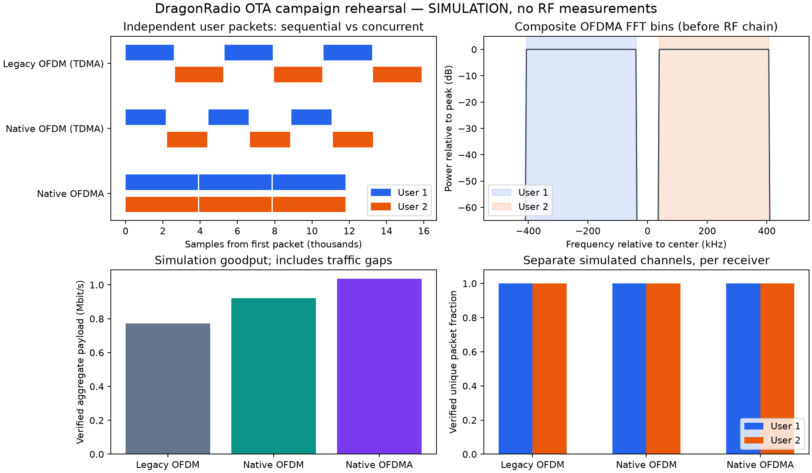

DragonRadio OTA PHY evaluation on the SDR grid
==============================================

Scope and current boundary
--------------------------

This experiment compares the original DragonRadio liquidDSP OFDM wrappers,
new FFTW OFDM, and static downlink OFDMA with one transmitter and two physically
separate receivers. All send the same two independent 256-byte payload streams,
with QPSK and CRC32 and no FEC, ARQ, TAP, IP, or production MAC. The original
``--phy ofdm`` radio remains available. This experiment does **not** establish
production DragonRadio network performance, default RS/Viterbi coding parity,
or real-time receiver capacity. Capturing IQ and decoding offline separates RF
loss from decoder overload. The next distinct integration gate is the C++ MAC,
ARQ, packet batching, and matched FEC; do not replace the production default on
the strength of these results.

``scripts/ota-phy.py`` is the common experiment tool. It never opens hardware
without ``--execute``. ``prepare``, ``simulate``, and ``analyze`` never import
UHD. ``preflight --execute`` opens RX only and reads configuration without a
stream command. No command reserves nodes, flashes FPGA/firmware, tunes host
networking, or starts a DragonRadio service automatically.

Reproducible experiment inputs
-----------------------------

From a source checkout with NumPy, FFTW single precision, a C++17 compiler, and
the pinned liquidDSP bridge built::

    python scripts/build-phy.py --fftw-prefix /usr
    python scripts/build-modem.py --fetch --fftw-prefix /usr
    PYTHONPATH=python/dragonradio python -m unittest discover -s tests/simulation -v
    python scripts/ota-phy.py prepare --campaign results/trial01 --frames 100
    python scripts/ota-phy.py simulate --campaign results/trial01

Use /opt/homebrew instead of /usr on Apple Silicon. Use a *fresh* directory for
every trial. The manifest records source/library hashes, random seed, carrier
mapping, expected payload hashes, packet sample intervals, IQ hashes, duration,
RMS, peak, and PAPR. Each payload contains a unique campaign tag, so a packet
from an earlier run cannot count as a success. Decoder inputs contain no expected
payload data. Verification happens after decoding. Refuse damaged waveforms.

The campaign creates legacy OFDM and native OFDM alternating full-band user-1
and user-2 packets, and native OFDMA carrying one packet for each user in the
same symbol interval. Sequence counters are independent. Default map: user 1
negative carriers -52..-5, user 2 positive carriers 5..52, FFT128, CP16, Fs1MS/s.
Each subband has 44 data and 4 pilot carriers. The composite active RMS is 0.08
for every candidate, with peak at most 0.5 and no clipping. TX preserves that
prepared scale. Equal *composite* power means OFDMA divides power between users;
report this explicitly. Digital RMS does not guarantee equal radiated power:
measure and record the RF chain's output power, spectrum, and attenuation.

The two OFDM waveforms occupy different airtimes (legacy training/header/tail
and new framing differ), and OFDMA shares the airtime between streams. Report
verified delivered payload bits divided by the scheduled traffic interval,
including inter-packet gaps and failed packets. Do not divide by only successful
packet airtime or by RX startup silence. Fixed startup/end guards are excluded.
The manifest provides that denominator; offered traffic is saturated. Also run
an equal offered-load experiment by pacing all three at the slowest candidate's
measured rate before drawing conclusions about queueing latency.

The pinned liquidDSP NCO uses an undefined negative float to ``uint32_t``
conversion. On arm64 (Apple Silicon) every negative CFO correction becomes
zero and legacy packets fail; Linux x86_64 builds wrap correctly and pass. See
``docs/characterization.rst`` (*Negative-CFO triage*). The default simulation
uses positive 0.1-subcarrier CFO and a short multipath channel. Repeat with
``--cfo -0.18`` and save a separate ``--output``; retain failures as
measurements rather than tuning only one candidate's channel. Native OFDM/OFDMA
acquisition is limited to roughly +/-0.25 subcarrier (about +/-2 kHz here);
measure the radios' actual relative offset before the first RF trial.

Grid preparation and reservation procedure
-----------------------------------------

1. On ``dwslgrid``, read ``gridcli status``, ``gridcli reservations``, and
   ``gridcli images``. Select three *available*, compatible radios and one
   explicitly owner-approved image. Record reservation owner/ID, node names,
   radio serials/models, image fingerprint, UHD version, and FPGA compatibility.
   Never reuse another experiment's reservation because its owner matches.
   The persistent controller is compute infrastructure, not a radio allocation.
2. Obtain the experiment's frequency, occupied bandwidth, TX power/gain cap,
   antenna/attenuation setup, burst count, and time window approval from the lab.
   A previous project's frequency approval does not authorize this experiment.
   Begin cabled through a splitter and adequate attenuation, or in a shielded
   setup; follow the lab's input-power limits. Surveying an apparently clear
   channel is not frequency authorization.
3. Launch a finite reservation with ``--no-flash``, no DragonRadio service, and
   no traffic. Verify the local ``gridcli reservation schedule --help`` syntax.
   If an FPGA/UHD mismatch is reported, stop and select a compatible image or
   request a separate firmware operation; do not repair it by flashing silently.
   Keep the exact returned reservation ID and a cleanup trap that stops only it.
4. Use verified SSH host keys scoped to the reservation. NFS homes may be shared;
   copy scripts/builds into a distinct container-local working directory rather
   than executing an NFS file that another job can replace. No private keys,
   credentials, raw captures, or reservation transcripts belong in Git.
5. Build the source bundle on Linux; never transfer a macOS library. Run
   ``grid/validate-simulation.sh`` and the three-way campaign simulation on the
   same code/library hashes used for RF. Check disk space: complex float32 IQ
   uses 8 MB per second at 1 MS/s per receiver (8-second pair: 128 MB/trial).
   Store capture locally during RX, then copy completed evidence to shared storage.
6. Probe each *reserved* radio read-only with the image's ``uhd_usrp_probe``;
   record serial, antennas, rate ranges, clock/time sources, LO lock, versions.
   Do not run simultaneous discovery commands against one device. The base
   DragonRadio image's UHD3.9 is not interchangeable with the UHD4.2 Python API
   used by this runner. Use an already compatible image; never globally replace
   /usr/local UHD to accommodate this test. The OpenISAC UHD4.2 image may be
   suitable only after its owner, runtime, and current FPGA compatibility check.
7. Create separate JSON configs for TX/RX1/RX2 using
   ``grid/sdr-config.example.json``. Set the explicit radio address, approved
   frequency, gain, antenna, and Fs1MS/s. For N210, use ``time_source: "none"``
   or the default empty string, not ``"internal"``; empty preserves device
   default. Internal clock does not imply internal PPS. No PPS synchronization
   is required here. For X310, read supported sources rather than assuming them.
   Inspect dry plans and run RX-only preflight on all three radios::

       python scripts/ota-phy.py preflight --campaign results/trial01 \
         --sdr-config rx1.json --execute --output preflight-rx1.json

   Confirm actual tuning/rate/gain, antenna, serial and clock selection. Receiver
   nodes remain RX-only throughout. All runs use one TX and at most 10 seconds
   of waveform; capture is bounded to 30 seconds. The runner also caps gain at
   20 dB; a smaller approved cap takes precedence. Gain is not calibrated dBm.

Per-mode run procedure
----------------------

Run from a controller tmux session or an existing grid-job runner so a laptop
sleep does not abandon the experiment. Commands below run on their respective
reserved nodes using *identical campaign contents*. ``shared`` is a private NFS
results directory visible to all three nodes; IQ itself may be container-local.
Choose MODE from legacy-ofdm, native-ofdm, native-ofdma. Use an independent ready
filename per mode/user. Start both RX processes first::

    python scripts/ota-phy.py rx --campaign results/trial01 --mode "$MODE" \
      --user 1 --sdr-config rx1.json --duration 8 \
      --ready "$shared/$MODE-u1-ready.json" --execute

On the other receiver use user 2, rx2.json, and the u2 ready file. Each writes a
readiness record only after receiving valid samples. TX requires two different
receiver hosts, matching campaign/mode/frequency/rate, fresh readiness and enough
remaining capture time. The ready files disappear when RX exits. Once both are
ready, run on TX::

    python scripts/ota-phy.py tx --campaign results/trial01 --mode "$MODE" \
      --sdr-config tx.json --require-ready "$shared/$MODE-u1-ready.json" \
      "$shared/$MODE-u2-ready.json" --execute

For unattended execution use the same finite node commands under a controller
script that waits for readiness with a timeout, checks child exit codes, and
terminates both RX process groups if TX fails. Do not proceed to another mode
after a driver failure. Use SIGINT, wait five seconds, then terminate only the
owned remaining process groups. Never kill other users' UHD processes.

The TX result must report burst acknowledgement with no underflow/late error.
RX writes .partial IQ until a successful stop, and marks discontinuity/timeout
or insufficient samples as incomplete. Do not silently count overflow as a
wireless packet loss. Copy completed RX .cf32/.json files and TX .json into one
campaign directory without overwriting another trial. Then::

    python scripts/ota-phy.py analyze --campaign results/trial01 --mode "$MODE"

This verifies capture hashes, campaign identities, rates and TX completion;
reports unique correct packets, duplicates, invalid payloads, per-user PDR with
Wilson 95% intervals, aggregate goodput, Jain fairness, and offline decoder CPU.
Native arrival offsets, EVM and CFO are in decoded reports. Legacy callback
sample timestamps are unavailable and are not fabricated. Device timestamps
are not comparable across unsynchronized radios; no end-to-end latency is claimed.
CPU decode time includes search over idle samples and excludes engine setup;
keep capture duration identical. Treat offline CPU headroom as a prerequisite,
not proof of real-time scheduling. Record wall-clock capture duration separately.

Meaningful demonstrations
--------------------------

A. Simultaneous independent delivery. Run all three modes with both receivers
   at robust SNR. Inspect the OFDMA manifest: paired packets have exactly the
   same sample interval; OFDM packets alternate. On both separate radios verify
   all campaign-tagged user-specific payloads. Plot per-user delivery vs sequence,
   aggregate goodput, fairness and occupied spectrum. This demonstrates one
   physical downlink serving two destinations concurrently, not two sequential
   transmissions renamed OFDMA. No extra interferer is needed.
B. Receiver and subband separation. Repeat at two different RX placements or
   independently controlled receive attenuation; keep TX power unchanged.
   Prepare a fresh campaign with ``prepare ... --swap`` and rerun. User 1 now
   occupies the positive subband and user 2 the negative subband. Compare EVM/PDR
   before/after swapping: frequency-selective effects should follow the subband,
   while a receiver's broadband attenuation follows that receiver. Retain both
   streams' hashes and confirm no packet from the other destination counts.
   Do not claim RF isolation merely from software address filtering. For a
   controlled notch experiment, use an approved passive/filter/channel-emulator
   setup; a radiating jammer is a separate experiment needing approval.
C. Robustness envelope. Sweep approved TX gain or receive attenuation, three
   independent repetitions at each point, alternating randomized mode order.
   Include independently clocked radios, both CFO signs when observed, clear
   LOS and a stable multipath placement. Compare OFDM parity first, then OFDMA
   aggregate gain and worst-user PDR. Track clipping, LO lock, CFO, EVM, actual
   rate, underrun/overflow and measured RF power with each point. Record geometry
   and do not move antennas between paired mode comparisons.

Decision gates and cleanup
-------------------------

* Simulation gate: all expected packets verified in all three modes at robust
  SNR; zero invalid hashes, and successful streaming tests with noisy idle time.
* Cabled gate: ten paired short trials per mode, robust SNR, PDR >=99% per user,
  zero discontinuities/underflows and no clipped samples. A 100-packet trial
  alone does not demonstrate 99% reliability at 95% confidence; aggregate at
  least 1000 packets/user and report confidence intervals and trial variability.
* OTA parity gate: matched uncoded native OFDM vs legacy OFDM in randomized
  repeated blocks, same RF power/airtime accounting and capture duration.
  Predeclare the application's acceptable PDR difference (e.g. 1 percentage
  point) and compare confidence intervals for the *difference*, with blocks as
  independent units; per-packet Wilson intervals alone ignore correlated fades.
  New OFDM should meet the agreed PDR margin and useful goodput target before
  attributing gains to OFDMA. Report CPU separately; don't hide search overhead.
* OFDMA gate: simultaneous independent payload validation on both receivers,
  worst-user reliability at target SNR, Jain fairness near 1 for equal allocations,
  and measured aggregate goodput exceeding the matched OFDM result with an
  uncertainty estimate. Airtime arithmetic alone is not an OTA result.
* Real-time gate: after capture-first results pass, connect online decode to a
  bounded queue, log overflow and CPU p95/p99 at continuous offered load, then
  integrate production MAC/ARQ and matched FEC. Maintain legacy OFDM throughout.

On every exit, stop only this experiment's processes/reservation, preserve the
private evidence directory and hashes, and verify the reservation is stopped.
Do not stop a persistent controller or another user's reservation. A failed
trial is retained with its cause. No new image publication, firmware change,
or RF transmission is implied by running the simulation gate.

Controller and paired-trial automation
--------------------------------------

``grid/run-trial.py`` implements the readiness/finite-process sequence above on
three already reserved nodes. Fill ``grid/trial-plan.example.json`` with the
actual reservation ID, this experiment's RF approval reference, paths and three
verified SSH hosts. Inspect the default dry plan, then execute only in the
approved window::

    python grid/run-trial.py --plan trial-plan.json --mode native-ofdma
    python grid/run-trial.py --plan trial-plan.json --mode native-ofdma --execute

It logs each role and controller exit status, requires fresh evidence paths,
and bounds every remote process with GNU timeout (SIGINT, then kill after five
seconds). A receiver failure before readiness prevents TX. On later failures,
RX is allowed to finish its finite capture for diagnosis. Copy results from
shared_results into the matching campaign when those paths differ. It does not
stop reservations automatically; that remains the outer reservation owner's
cleanup trap. The example assumes a trusted shared filesystem visible under
the same absolute path on controller and nodes. For high-rate work replace NFS
capture output with local disk and explicitly collect after completion.

After at least three, preferably ten independent paired trials, analyze each
mode first and summarize using::

    python scripts/summarize-ota.py results/trial01 results/trial02 results/trial03 \
      --margin 0.01 --output results/comparison.json

This checks matching code/build/settings and distinct campaign identities, then
bootstraps complete trial blocks for per-user PDR differences and aggregate
goodput differences. It reports whether the declared native OFDM reliability
margin and OFDMA gain are supported by those intervals. Stratify different
antenna placements, carrier swaps, power points, and software builds rather
than mixing them. Do not interpret a small number of identical trials as proof
that rare fades cannot occur. CPU measurements and calibration records still
need review alongside these statistics.

Simulation demonstration figure
-------------------------------

Regenerate with ``python scripts/plot-ota-demo.py --campaign results/trial01
--output results/trial01/demo.png`` after simulation. This figure is explicitly
labelled simulation and uses the exact prepared waveform. It is not RF spectrum
analyzer data or an OTA throughput claim.

Validation completed 2026-11-02
-------------------------------

Both native FFTW and pinned liquidDSP bridges were built in an isolated Ubuntu
24.04 x86_64 workspace on the existing grid controller. All 42 tests passed on
Linux and macOS. The three-way simulation delivered 100/100 packets per user
in each mode, with multipath and 0.1-subcarrier CFO. The swapped-subband
demonstration also passed locally. No SDR was opened, no RF transmitted, no
reservation created and no firmware modified.

A Linux CPU benchmark (500 timing iterations, 300 packets per SNR/profile point)
passed all six existing gates. Native OFDM TX/RX medians were 56.77/84.49 us,
versus legacy liquidDSP 75.37/199.18 us: summed medians improve by 1.94 times.
Native OFDMA improves by 12.52 times over the initial Python reference. These
are warmed frame-processing measurements, excluding initialization, hardware
I/O and streaming idle-time search; they are not OTA or full-stack throughput.
Reports are saved under simulation-results/ota-linux-*.json and the local
rehearsal/swap campaign directories. The private source bundle contains the
runner, tests and procedure, but excludes these generated results and captures.
